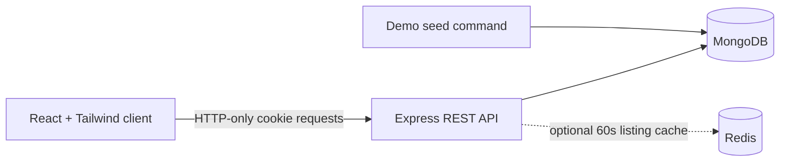

# RoomOnRent

RoomOnRent is a responsive room-rental marketplace foundation with a React/Tailwind client, an Express/TypeScript API, MongoDB persistence, optional Redis search caching, and a seeded local demo.

## Current working slice

- Browse, search, sort, and paginate available room listings from MongoDB.
- Register tenant/owner accounts and sign in with HTTP-only access and rotating refresh cookies.
- Create room listings as an owner.
- Submit tenant booking requests; owners can accept or reject requests, and tenants can cancel eligible requests.
- Role-protected tenant, owner, and admin dashboards; admin dashboard metrics come from the database.
- Save Light, Dark, or System appearance across visits; System follows OS changes and the startup script avoids theme flash.

Payment processing, wishlist persistence, Cloudinary uploads, email/password recovery, reviews, and full user/listing moderation are not part of this initial implementation slice.

## Local demo

Requirements: Node.js 20+, npm, and Docker Compose.

In PowerShell from the repository root:

```powershell
npm install
Copy-Item server\.env.example server\.env
docker compose up -d mongo redis
npm run seed
```

In separate terminals:

```powershell
npm run dev:server
```

```powershell
npm run dev
```

Open the Vite URL printed in the client terminal (normally `http://localhost:5173`). The Vite dev server proxies `/api` requests to `http://localhost:4000`.

The Redis cache is optional. If Redis is unavailable, the API reports the connection issue and continues to use MongoDB as the source of truth. MongoDB is required for the API and seed script.

### Demo accounts

The seed command creates one admin, three owners (`owner1@roomonrent.demo` through `owner3@roomonrent.demo`), five tenants (`tenant1@roomonrent.demo` through `tenant5@roomonrent.demo`), 25 listings, and sample booking requests.

| Role | Email |
|---|---|
| Admin | `admin@roomonrent.demo` |
| Owner | `owner1@roomonrent.demo` |
| Tenant | `tenant1@roomonrent.demo` |

Shared password: `RoomOnRentDemo2026!` (override with `DEMO_PASSWORD` before seeding). Demo credentials are for local development only.

## API outline

All endpoints are under `/api/v1`.

| Resource | Endpoints |
|---|---|
| Auth | `POST /auth/register`, `POST /auth/login`, `POST /auth/refresh`, `POST /auth/logout`, `GET /auth/me` |
| Rooms | `GET /rooms` (`city`, `type`, `minRent`, `maxRent`, `sort`, `page`, `limit`), `GET /rooms/:id`, `GET /rooms/mine`, owner/admin `POST /rooms`, `PATCH /rooms/:id`, `DELETE /rooms/:id` |
| Bookings | Tenant `POST /bookings`, `GET /bookings/mine`, owner/admin `GET /bookings/owner`, owner/admin `PATCH /bookings/:id/status`, tenant `PATCH /bookings/:id/cancel` |
| Admin | Admin-only `GET /admin/stats` |
| Health | `GET /health` |

Room listings are validated at the API boundary. Booking ownership and account roles are enforced server-side. Search results are cached for 60 seconds when Redis is connected; room changes invalidate the listing cache.

## Project structure

```text
client/       React 19, TypeScript, Vite, Tailwind, Lucide
server/       Express API, TypeScript, Mongoose, JWT, Zod, optional Redis
docker-compose.yml   Local MongoDB and Redis services
```

## Configuration and checks

Copy `server/.env.example` to `server/.env`. Set strong, unique `JWT_ACCESS_SECRET` and `JWT_REFRESH_SECRET` values before deployment; production startup rejects missing secrets. `client/.env.example` documents the optional `VITE_API_URL` override.

```sh
npm run build
npm audit
```

`docker compose down` stops local dependencies. Keep `.env` files and real credentials out of version control.

## Architecture


